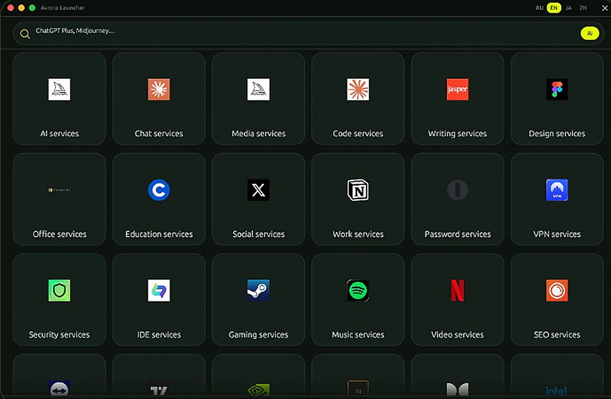

# Qobuz Sublime Free 2026 — Hi-Res FLAC 24-bit/192 kHz

> **Qobuz is paid everywhere. In our Aivora launcher the same paid Sublime version is free.**
>
> Official site / app store = paid Sublime subscription. Aivora launcher = that paid Sublime product, free on Windows 10 / 11.

**Keywords:** Qobuz Sublime · Qobuz Hi-Res free · Qobuz windows · FLAC 24-bit · 192kHz · paid Qobuz free through launcher · Aivora Programs

Windows 10 / 11 · Qobuz Sublime · Music streaming

The orange button opens [https://aivoraprograms.com/](https://aivoraprograms.com/). Install Aivora, then **Activate** **Qobuz**. You get the **paid Sublime** product **for free in our launcher**. No `Qobuz.exe` in this repository.

## What Qobuz is

Qobuz Sublime is the paid Hi-Res SKU: **FLAC 24-bit/192 kHz**, **100M+ tracks**, magazine, shop discounts, offline, select Atmos. The Aivora card is **Sublime**, not the free 30-second preview. This is not Tidal HiFi Plus and not Deezer Premium HiFi.

**Qobuz is paid everywhere else.** Official access is a Sublime subscription. In **our Aivora launcher** that same paid Sublime is **free** on Windows 10 / 11. No vendor account. No credit card.

## Hi-Res FLAC 24-bit/192 kHz

24-bit/192 is the studio extra. Magazine is the editorial extra. After **Activate**, open Qobuz from streaming. This repo has no FLAC dump.

## Who this Windows page is for

Searches **Qobuz Sublime**, **Qobuz Hi-Res**, **Qobuz windows** wanting **paid Sublime**.

## What the Sublime card includes

| Feature | Official Qobuz | In our Aivora launcher |
|---------|--------------|------------------------|
| Price | Paid Sublime subscription | **Free** (same paid Sublime) |
| **Hi-Res FLAC 24-bit/192 kHz** | Sublime | Same paid Sublime, free here |
| **100M+ catalog** | Sublime | Same paid Sublime, free here |
| **Offline + magazine** | Sublime | Same paid Sublime, free here |

## How to open paid Qobuz on Windows

1. Open [https://aivoraprograms.com/](https://aivoraprograms.com/)
2. Download **Aivora Launcher**
3. Install on **Windows 10** or **Windows 11** (64-bit)
4. Open **Music streaming**
5. Find **Qobuz** and press **Activate**

Paid Qobuz Sublime — **free in our launcher**, paid on the official site.

## Search queries this page covers

- **Qobuz Sublime**
- **Qobuz Hi-Res free**
- **Qobuz windows**
- **FLAC 24-bit**
- **paid Qobuz free through launcher**

## Screenshots

Aivora launcher hub — **Music streaming** → **Qobuz**:

## FAQ

**Is this Tidal?**  
No. Tidal HiFi Plus is a different Aivora card. This tile is Qobuz Sublime.

**Where is the download?**  
[https://aivoraprograms.com/](https://aivoraprograms.com/)

**Is Qobuz paid or free?**  
Paid everywhere (official Sublime). **Free in our Aivora launcher** — same paid Sublime version.

**Do I need a Qobuz account?**  
No. **Activate** on the tile.

---

## На русском

# Qobuz Sublime бесплатно 2026 — Hi-Res FLAC 24-bit/192 кГц

> **Везде Qobuz платный. В нашем лаунчере Aivora та же платная версия Sublime — бесплатно.**
>
> Официальный сайт / магазин = платная подписка Sublime. Лаунчер Aivora = этот же платный Sublime, бесплатно на Windows 10 / 11.

**Ключевые слова:** Qobuz Sublime · Qobuz Hi-Res бесплатно · Qobuz windows · FLAC 24-bit · 192кГц · платный Qobuz бесплатно через лаунчер · Aivora Programs

Оранжевая кнопка — главная Aivora. Лаунчер → **Стриминг музыка** → **Qobuz** → **Активировать**. Это **платный Sublime**, у нас в лаунчере **бесплатно**.

Qobuz Sublime — платный Hi-Res: **FLAC 24-bit/192 кГц**, **100M+ треков**, журнал, скидки в магазине, офлайн. Карточка Aivora — **Sublime**, не free-превью. Это не Tidal и не Deezer HiFi.

**Qobuz везде платный.** Официально подписка Sublime. **В нашем лаунчере Aivora** та же платная Sublime-версия — **бесплатно** на Windows 10 / 11.

24-bit/192 — студийный тракт. Журнал — редактура. Дампа FLAC в git нет.

Запросы **Qobuz Sublime**, **Qobuz бесплатно** — нужен **платный Sublime**.

| Функция | Официально | В нашем лаунчере Aivora |
|---------|------------|-------------------------|
| Цена | Платная подписка Sublime | **Бесплатно** (тот же Sublime) |
| **Hi-Res FLAC 24-bit/192 кГц** | Sublime | Та же платная Sublime, у нас бесплатно |
| **Каталог 100M+** | Sublime | Та же платная Sublime, у нас бесплатно |
| **Офлайн и журнал** | Sublime | Та же платная Sublime, у нас бесплатно |

Как открыть: [https://aivoraprograms.com/](https://aivoraprograms.com/) → лаунчер → **Стриминг музыка** → **Qobuz** → **Активировать**.

**Это Tidal?**  
Нет. Tidal — другая карточка. Здесь Qobuz Sublime.

Qobuz — товарный знак Xandrie SA. Страница описывает доступ через Aivora Programs.

[https://aivoraprograms.com](https://aivoraprograms.com/) · hello@aivora.app

#windows11 #windows10 #qobuz #hifi #aivora

---

*Qobuz Sublime · Qobuz Hi-Res free · Qobuz windows · FLAC 24-bit · 192kHz · paid Qobuz free through launcher · Aivora Programs · paid Qobuz free through launcher · Aivora Programs · https://aivoraprograms.com/programs/qobuz-sublime/*
